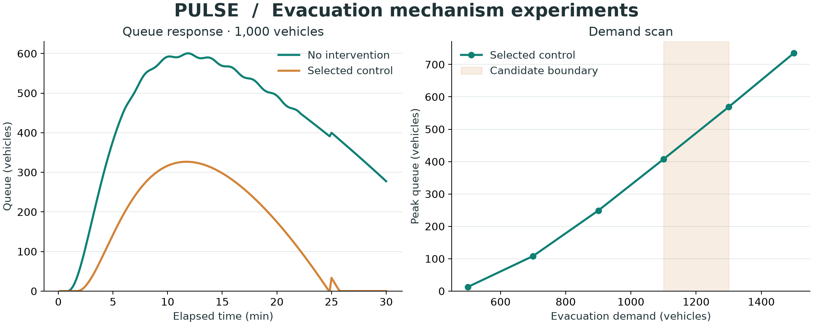

# PULSE

PULSE 用于比较疏散策略对排队、完成率、容量利用和区域协调的影响。它包含可快速运行的机理模型、街区与居民级模拟器，以及带输入口径和数据来源的实验样例。



## 快速开始

所有 Python 命令都在 Conda 环境中执行。推荐 Python 3.12。

```bash
conda env create -f environment.yml
conda run -n pulse python -m pip install -e '.[city,plots,dev]'
conda run -n pulse pulse-explore
```

已有 `pulse` 环境时跳过创建步骤。只运行机理模型可安装 `-e .`，不需要 NumPy、PyTorch、GPU 或模型权重。

默认输出写入 `results/demo/`：

- `summary.json`：基准、选中策略、三个种子及需求扫描结果。
- `trials.json`：20 次候选策略试验。
- `demand_scan.csv`、`queue_series.csv`：数值结果及基准/选中策略的队列时序。
- `queue_response.svg`、`demand_boundary.svg`：使用共同坐标尺度的图表。

```bash
conda run -n pulse pulse-explore --help
conda run -n pulse pulse-explore --version
conda run -n pulse pulse-explore --output results/demo
conda run -n pulse python scripts/plot_demo.py
```

## 城市模拟

本地 CPU Demo 使用全新合成的 4 × 4 街区、1,600 名居民和 16 个避难所，无须外部地理数据或推理服务：

```bash
conda run -n pulse python scripts/run_city_demo.py
```

该命令运行 180 步，输出 `results/city_demo/summary.json`、街区帧和抽样轨迹，并检查人口守恒及避难所容量。它验证程序运行，不代表真实城市效果。

`scripts/bench_swarm.py` 支持自定义城市缓存、道路损伤、知识传播、LLM 协调、事件流和轨迹导出。默认大规模入口使用 CUDA；CPU 应使用小型输入。成都人口输入包含 20,937,757 名合成居民，完整运行需要相应内存及计算资源。LLM 模式另外需要本地 llama.cpp 服务与单独取得的模型权重。

运行参数与配置见 [运行说明](docs/RUNNING.md)。数据来源、字段及假设见 [数据说明](data/DATA_SOURCES.md) 和 [数据字典](results/DATA_DICTIONARY.md)。

## 检查与开发

```bash
conda run -n pulse python -m unittest discover -s tests -v
conda run -n pulse python scripts/verify_evidence_chain.py
conda run -n pulse python -m build --no-isolation
```

`verify_evidence_chain.py` 检查机理模型、单元测试及随附 48 份样例的守恒、容量、数据表再生和配对关系。样例核验不等于重新运行完整城市实验。只安装基础包时，城市测试会明确跳过；安装 `city` 依赖后执行。

开发和 Python API 见 [开发说明](docs/DEVELOPMENT.md)。本项目提供 CLI、JSON/CSV 和图表，没有网页前端。

## 许可

Copyright (C) 2026 Ustinian5。PULSE 原创代码采用 [AGPL-3.0-only](LICENSE)。外部数据、模型和依赖保留各自条款，详见 [第三方声明](THIRD_PARTY_NOTICES.md)。本模型用于科研和情景比较，尚未针对真实疏散事件完成校准。
